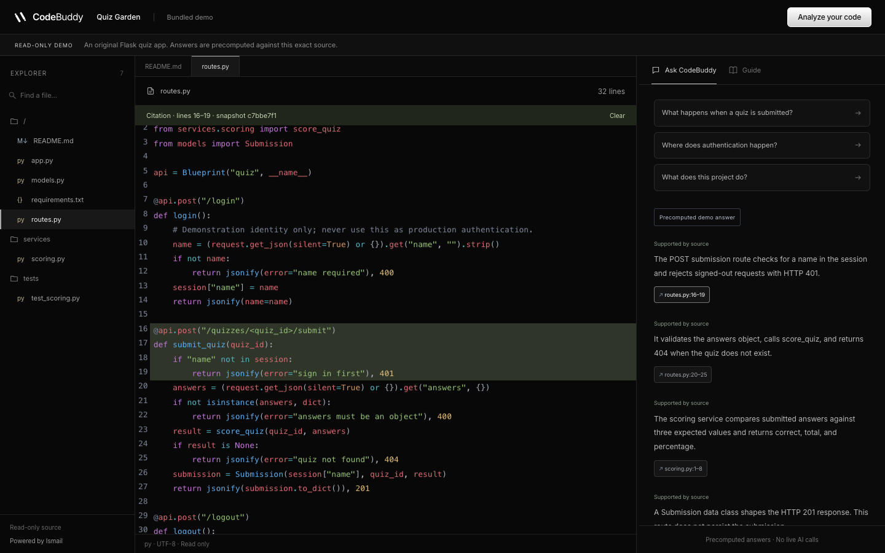

# CodeBuddy

[](https://github.com/Ismail-ux23/CodeBuddy/actions/workflows/ci.yml)
[](LICENSE)

**Understand your code. Build with confidence.**

CodeBuddy helps developers explore an unfamiliar Python, JavaScript, or TypeScript codebase.
Upload a source ZIP, review the sanitized files, approve AI indexing, and ask questions with
clickable citations to the exact source lines. It also generates a cited onboarding guide.

Built by [Ismail Manzoor](https://github.com/Ismail-ux23).



## Try it locally

### Frontend and bundled demo

Requires Node.js 24 and npm. No AI key, database, or account is needed for the precomputed demo.

```sh
git clone https://github.com/Ismail-ux23/CodeBuddy.git
cd CodeBuddy/frontend
npm ci
npm run dev
```

Open [localhost:3000/demo](http://localhost:3000/demo). Demo answers are explicitly labeled
as precomputed and cite the bundled synthetic Flask repository.

### Full application with Docker

Requires Docker with Compose and a free port 8080. Start from the repository root:

```sh
cp .env.example .env
python3 -c "import secrets; print(secrets.token_hex(32))"
# Put the generated value in APP_SECRET_KEY in .env.
# Add GEMINI_API_KEY for live indexing and questions.
docker compose up --build -d
```

Open [localhost:8080](http://localhost:8080), register, create a project, and upload
`demo/quiz-garden.zip`. Review the source preview and approve indexing. Once it finishes,
ask “What happens when a quiz is submitted?” and open a citation.

Without a Gemini key, the public demo and private source previews remain available;
live indexing and answers return an explicit provider-unavailable message.
Full Compose startup still requires verification on a Docker-equipped machine.

## Features

- Private accounts and projects with Argon2 passwords, Redis sessions, CSRF, and ownership checks.
- Bounded ZIP inspection, exclusion reports, source preview, heuristic credential redaction,
  and explicit consent before source is sent to Gemini.
- Immutable source snapshots with Python/JS/TS parsing and bounded text fallback.
- PostgreSQL full-text and pgvector search combined using reciprocal rank fusion.
- Structured AI answers with server-validated citation IDs and source line ranges.
- Persistent Celery jobs with progress events, polling fallback, cancellation, and explicit retry.
- Conversation history, feedback, source viewing, and onboarding guide export to Markdown.
- Responsive black landing page with local animation, pause controls, and reduced-motion support.

## Stack

| Layer | Technologies |
| --- | --- |
| Frontend | Next.js 16, React 19, TypeScript, CodeMirror, TanStack Query |
| API | Python 3.12–3.14, Flask, Pydantic, SQLAlchemy, Alembic |
| Retrieval | PostgreSQL, pgvector, full-text search, Tree-sitter |
| AI | Google Gemini SDK for embeddings and structured answers |
| Background jobs | Celery and Redis |
| Deployment | Docker Compose, Gunicorn, Nginx |
| Checks | pytest, Ruff, Vitest, TypeScript, Playwright, GitHub Actions |

Dependencies are locked in `backend/uv.lock` and `frontend/package-lock.json`.
Model defaults are in `.env.example`; confirm availability and quotas for your Google account.
Embeddings use 768 dimensions. Changing dimensions requires a database migration and reindex.

## Development and checks

See [setup](docs/setup.md) for PostgreSQL/Redis configuration and non-container development.

```sh
make install
make lint
make test
make build
python3 scripts/verify_demo.py
cd frontend && npx playwright install chromium && npm run test:e2e
```

Backend integration tests require `TEST_DATABASE_URL` and `TEST_REDIS_URL` pointing to
disposable services. They skip without those settings. The fixtures delete database tables.
GitHub Actions provisions PostgreSQL with pgvector and Redis for the integration suite.

[Current review results](docs/github-readiness.md) distinguish executed checks from pending
checks. This is a portfolio release candidate; passing tests cannot prove the absence of all bugs.
Live AI quality, Docker startup, and broader concurrency behavior require further acceptance.

## Documentation

- [Architecture](docs/architecture.md) — data flow and design tradeoffs.
- [API specification](docs/api.yaml) — HTTP endpoints.
- [Security and data flow](docs/security-and-data-flow.md) — source privacy and processing boundaries.
- [Deployment](docs/deployment.md) — production configuration notes.
- [Limitations](docs/limitations.md) — remaining scope and verification gaps.
- [Historical test report](docs/test-report.md) — results recorded before this review.
- [Evaluation cases](evals/README.md) — retrieval and answer-quality evaluation fixtures.

## Contributing and license

See [CONTRIBUTING.md](CONTRIBUTING.md). Report vulnerabilities privately as described in
[SECURITY.md](SECURITY.md). Licensed under [MIT](LICENSE).
